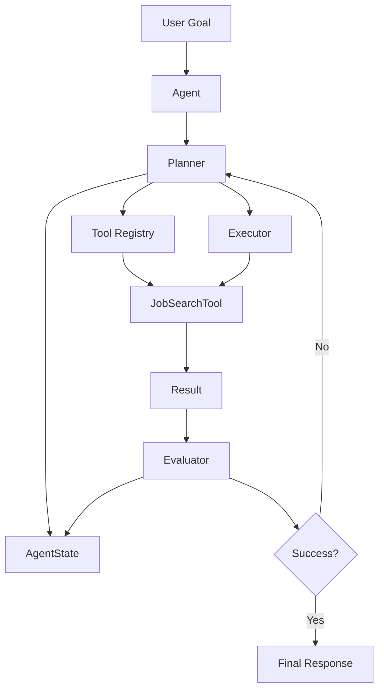
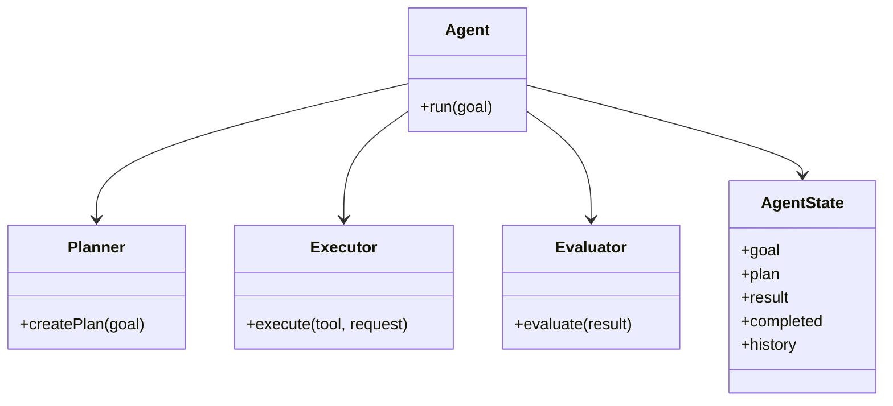
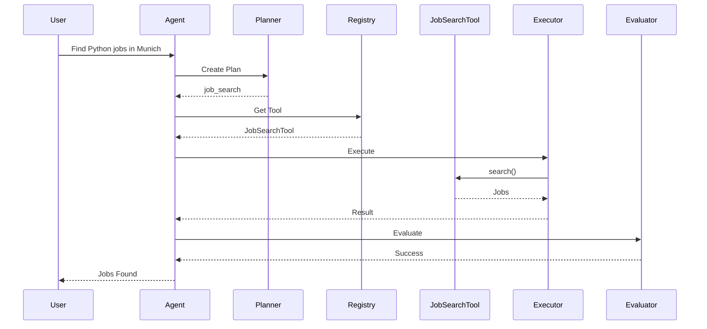

# Catalyst Architecture

## Setup

```bash
python -m venv .venv
.venv\Scripts\activate
pip install -e .
pip list
```

---

## Agent Architecture



---

## Core Components



---

## Request Flow



---

## Current Project Structure

```text
catalyst-java/

├── pom.xml
│
└── src/
    └── main/
        └── java/
            └── com/
                └── catalyst/
                    │
                    ├── Application.java
                    │
                    ├── core/
                    │   ├── Agent.java
                    │   ├── AgentState.java
                    │   ├── Planner.java
                    │   ├── Executor.java
                    │   └── Evaluator.java
                    │
                    ├── domain/
                    │   └── Job.java
                    │
                    └── tools/
                        ├── BaseTool.java
                        ├── ToolRegistry.java
                        └── JobSearchTool.java
```

```text
catalyst-python/

├── pyproject.toml
│
├── catalyst/
│
│   ├── core/
│   │   ├── agent.py
│   │   ├── state.py
│   │   ├── planner.py
│   │   ├── executor.py
│   │   └── evaluator.py
│   │
│   ├── domain/
│   │   └── job.py
│   │
│   ├── tools/
│   │   ├── base_tool.py
│   │   ├── registry.py
│   │   └── job_search_tool.py
│   │
│   ├── agents/
│   │
│   ├── workflows/
│   │
│   ├── context/
│   │
│   ├── memory/
│   │
│   └── mcp/
│
└── tests/
```

---

## Learning Objective (1.1 Agentic Loops)

```text
Goal
 ↓
Plan
 ↓
Select Tool
 ↓
Execute Tool
 ↓
Observe Result
 ↓
Evaluate
 ↓
Respond
```

Everything later in the Claude Code Certification builds on:

```text
Agent
AgentState
Planner
Executor
Evaluator
```
