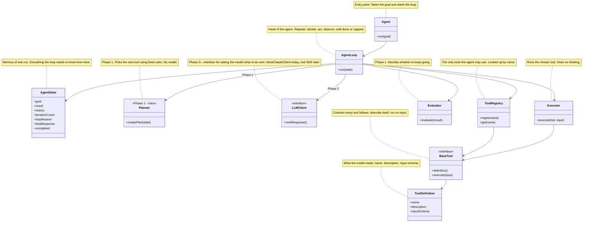
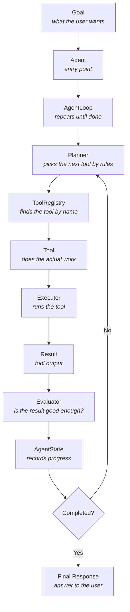
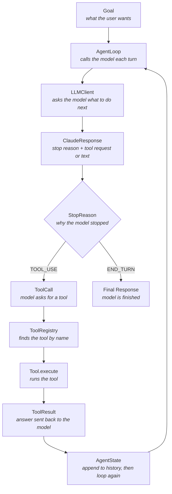
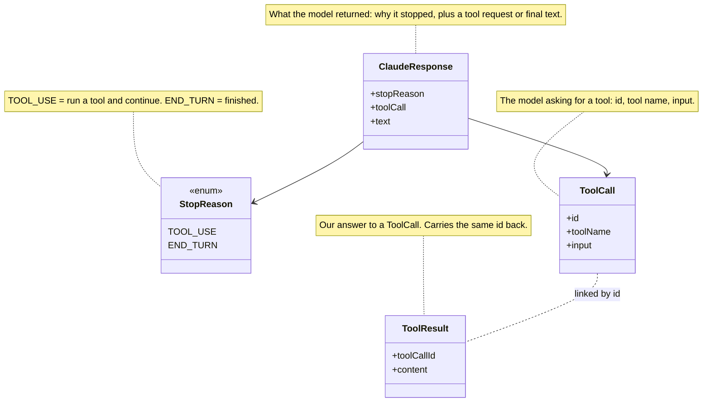
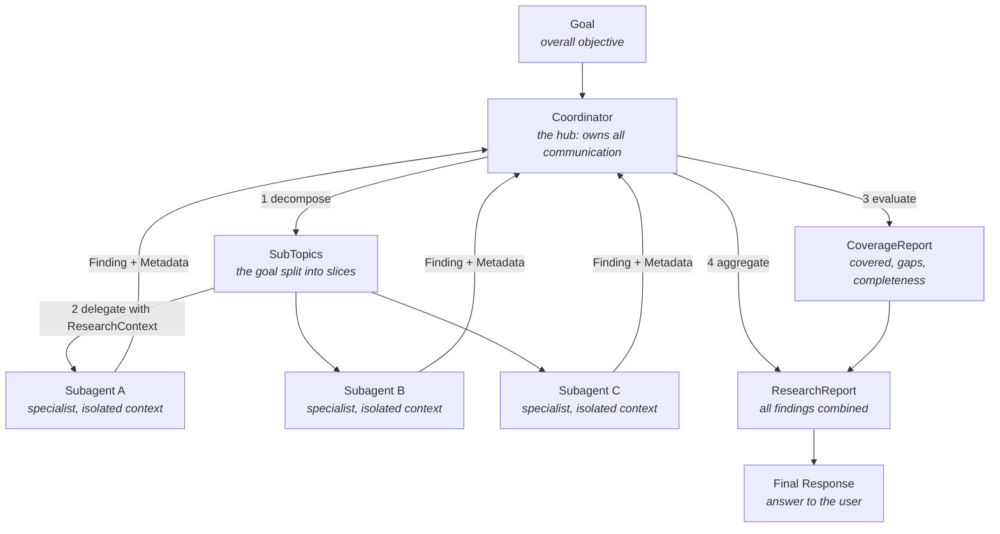
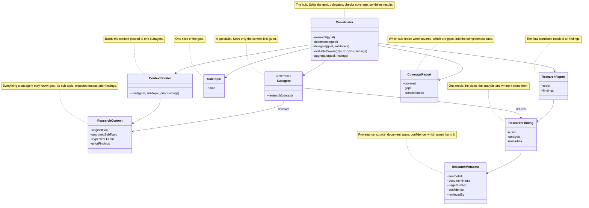

# Catalyst Agent Architecture Reference

A generic, tool-agnostic reference for building agents with the Claude loop model. It describes the components, how they connect and the rules that keep an agent reliable. It deliberately uses no domain examples: replace `Tool A`, `Subagent A` etc. with your own.

## Setup

```bash
python -m venv .venv
.venv\Scripts\activate
pip install -e .
pip list
```

---

## 1. What an Agent Is

An agent takes a **goal**, repeatedly **decides** the next action, **acts** through tools, **observes** the result and stops when the goal is met.

```text
Goal -> Decide -> Act (tool) -> Observe -> Evaluate -> repeat or finish
```

---

## 2. Core Components (single agent)



| Component | Responsibility |
|-----------|----------------|
| `Agent` | Entry point: `run(goal)` creates the state and starts the loop |
| `AgentLoop` | Repeats decide -> act -> observe until finished or capped |
| `AgentState` | Memory of the run (goal, history, counters, stop reason, final answer) |
| `Planner` | Rule-based "what next?" (Phase 1, no model) |
| `LLMClient` | Model-based "what next?" (Phase 2+; a mock first, real SDK later) |
| `Executor` | Runs the selected tool; does no thinking |
| `Evaluator` | Decides whether to continue (rule based) |
| `ToolRegistry` | Lookup of the tools the agent is allowed to use (a safety boundary) |
| `BaseTool` / `ToolDefinition` | Tool behaviour and the metadata (name, description, input schema) the model reads |

**Principle:** only the "what next?" part (Planner, then LLMClient) changes between phases. State, loop, registry and tools stay the same.

### Planner vs LLMClient (the one part that changes)

`Planner` is a plain class. `LLMClient` is a real interface (`MockClaudeClient` implements it; the real SDK client will too). They are used by two separate loops and share no common parent, because their outputs differ:

| | `Planner` | `LLMClient` (implemented by `MockClaudeClient`) |
|---|---|---|
| Used by | `AgentLoop` (Phase 1) | `AgentLoopV2` (Phase 2) |
| How it decides | Fixed rules in code (goal text -> tool name) | The model chooses; the mock replays a script |
| Output | The tool to run | `ClaudeResponse` with a `StopReason` |
| Who says "finished" | `Evaluator` | `StopReason.END_TURN` |

Both answer the same question on every iteration: **"what should the agent do next?"** Phase 2 replaces the rule-based answer with the model's answer. Later phases keep the Phase 2 loop and swap the mock for the real SDK.


---

## 3. Rule-Based Loop (Planner + Evaluator)



---

## 4. Claude Tool Loop (model-driven)

The model decides. The loop reacts to the **stop reason**.



### Loop in pseudocode

```text
while not completed:
    if iterationCount >= MAX_ITERATIONS: warn, break      # safety cap only
    iterationCount++
    response = client.nextResponse(history, tools)
    state.stopReason = response.stopReason

    if response.stopReason == END_TURN:
        state.finalResponse = response.text
        state.completed = true
        break

    if response.stopReason == TOOL_USE:
        tool   = registry.get(response.toolCall.name)
        output = tool.execute(response.toolCall.input)
        history.append(ToolResult(response.toolCall.id, output))
```

### Differences between the two loops

| | Rule-based loop | Model-driven loop |
|---|---|---|
| Who decides the next step | `Planner` | The model, via `ClaudeResponse` |
| Continue / stop signal | `Evaluator` | `StopReason` (`TOOL_USE` / `END_TURN`) |
| Tool request | Planner picks a tool name | `ToolCall` |
| Tool output | `Result` | `ToolResult` |
| Safety cap | optional | `MAX_ITERATIONS` |

### Data types



### Sequential tool calls

```text
Iteration 1: TOOL_USE (Tool A)
Iteration 2: TOOL_USE (Tool B)   <- may depend on Tool A's result
Iteration 3: END_TURN

iterationCount = 3, history size = 2, completed = true
```

Iterations = tool calls + 1 (the final `END_TURN` call is counted but runs no tool).

---

## 5. Multi-Agent Orchestration (hub-and-spoke)



**Key rule:** subagents never talk to each other. All communication and context flows through the coordinator.

| Step | Coordinator action |
|------|--------------------|
| Decompose | Split the goal into sub-topics |
| Delegate | Build a context per sub-topic and call the matching subagent |
| Evaluate coverage | Compare planned sub-topics with findings; list covered, gaps, completeness |
| Refine | Re-delegate for gaps (planned, not required for a first version) |
| Aggregate | Combine findings into one report |

### Multi-agent data model



### Context passing

A subagent has **isolated context**: it knows only what is in its `ResearchContext`. Always pass:

```text
originalGoal      the overall objective
assignedSubTopic  this subagent's slice
expectedOutput    the format to return
priorFindings     earlier findings it needs (flows through the coordinator only)
```

### Provenance

Every finding carries `ResearchMetadata` (source, document, page, confidence, which agent retrieved it). Unknown fields stay `null`; never invent them. This allows conflicts between sources to be annotated instead of silently merged.

---

## 6. Phases

| Phase | Focus | Decision maker |
|-------|-------|----------------|
| 1 | Single agent architecture: Agent, AgentState, Planner, Executor, Evaluator, AgentLoop, tools | `Planner` (rules) |
| 2 | Claude-style loop: `StopReason`, `ToolCall`, `ToolResult`, `ClaudeResponse`, mock client | Mock `LLMClient` |
| 2.5 | Sequential tool calls: `TOOL_USE` -> `TOOL_USE` -> `END_TURN` | Mock `LLMClient` |
| 3 | Multi-agent: coordinator, subagents, decomposition, delegation, aggregation, coverage | Coordinator |
| 4 | Context passing and provenance: `ResearchContext`, `ContextBuilder`, `ResearchMetadata` | Coordinator passes context |
| Next | Replace the mock with the real SDK (`client.messages.create()`) | Real model |

Phase documents: `catalyst-java/Catalyst_Phase1_Agent_Architecture.md`, `Catalyst_Phase2_Claude_Tool_Loop.md`, `Catalyst_Phase3_MultiAgent_Orchestration.md`.
Study guide: `catalyst-java/go-to/Catalyst_Prep_Guide.html`.

---

## 7. Rules That Keep an Agent Reliable

1. **`stop_reason` is the loop signal.** `tool_use` -> run the tool and continue. `end_turn` -> finish.
2. **Never** decide completion by parsing the model's text, by checking only the first content block, or by an iteration cap.
3. **The iteration cap is a safety bound** against runaway loops, not the normal exit. Warn when it trips.
4. **Append every tool result to the history** before the next model call. Shrink tool output if it is too large; do not drop it.
5. **Only registered tools can run.** The registry is a safety boundary. Unknown tool names must fail safely.
6. **Tool descriptions drive selection.** State inputs, outputs and "do not use for X" boundaries. Give each agent a small, relevant tool set.
7. **Return structured errors** from tools: category (transient / validation / business / permission), retryable flag, message. Distinguish a valid empty result from a failure.
8. **Enforce hard policies in code** (hooks, prerequisite gates), not in prompts.
9. **Subagents get explicit context.** They do not inherit the coordinator's conversation.
10. **Independent subtasks can run in parallel** (several delegations in one step).
11. **Coverage metrics must be able to fail.** Compare planned topics with findings that contain real evidence.
12. **Keep claims with their sources** and annotate conflicts.
13. **Escalate with a structured summary** (issue, actions taken, facts, recommended next step), and honor explicit requests for a human.
14. **Use a mock client for tests** so loop logic is deterministic and needs no keys, credits or network.

---

## 8. Claude Concept Mapping

| Claude concept | Component |
|----------------|-----------|
| Agent runtime / `while(true)` | `Agent` / `AgentLoop` |
| `messages[]` | `AgentState.history` |
| `tools[]` | `ToolRegistry` + `ToolDefinition` |
| `client.messages.create()` | `LLMClient` (mock first) |
| `stop_reason` | `StopReason` |
| `tool_use` block | `ToolCall` |
| `tool_result` block | `ToolResult` |
| `end_turn` | `StopReason.END_TURN` |
| Safety bound | `MAX_ITERATIONS` |
| Coordinator / subagents (Task tool) | `Coordinator` / `Subagent` |
| Task decomposition | `decompose()` |
| Subagent context passing | `ResearchContext` |
| Provenance | `ResearchMetadata` |
| Coverage evaluation | `CoverageReport` |

---

## 9. Testing Strategy

| Area | What to verify |
|------|----------------|
| Decision maker | Goal -> expected action |
| Registry | Register, look up, unknown name handled |
| Loop | Iterations counted, completes on `END_TURN`, cap enforced |
| Mock client | Scripted responses come out in order |
| Sequential calls | `TOOL_USE`, `TOOL_USE`, `END_TURN`: iterations 3, history 2 |
| Coordinator | Decompose, delegate, coverage, aggregate |
| Subagents | Return a finding for the context they receive |
| Context | Context built correctly and passed unchanged |
| Isolation | A subagent uses only the context it was given |
| Metadata | Provenance survives into the finding |

---

## 10. Module Layout (generic)

```text
project/
    core/        Agent, AgentState, Planner, Executor, Evaluator, AgentLoop
    llm/         StopReason, ToolCall, ToolResult, ClaudeResponse, LLMClient (mock, later real)
    tools/       BaseTool, ToolDefinition, ToolRegistry, <your tools>
    agents/      Coordinator, <your subagents>
    context/     ContextBuilder
    model/       SubTopic, ResearchContext, ResearchFinding, ResearchMetadata,
                 ResearchReport, CoverageReport
    phases/      runnable demos per phase
    tests/       one test group per area above
```

---

## 11. Learning Objective (1.1 Agentic Loops and beyond)

```text
Goal -> Plan -> Select Tool -> Execute Tool -> Observe Result -> Evaluate -> Respond
```

Everything later in the Claude Certified Architect material builds on: Agent, AgentState, Planner / LLMClient, Executor, Evaluator, AgentLoop, ToolRegistry, StopReason, Coordinator, context passing and provenance.
