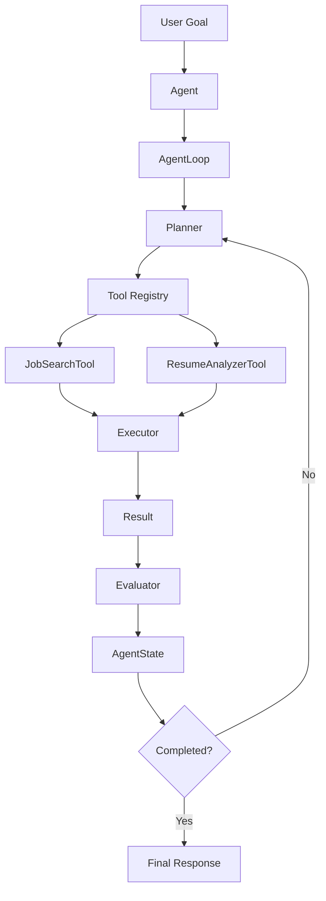
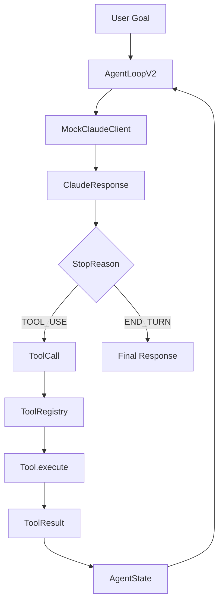
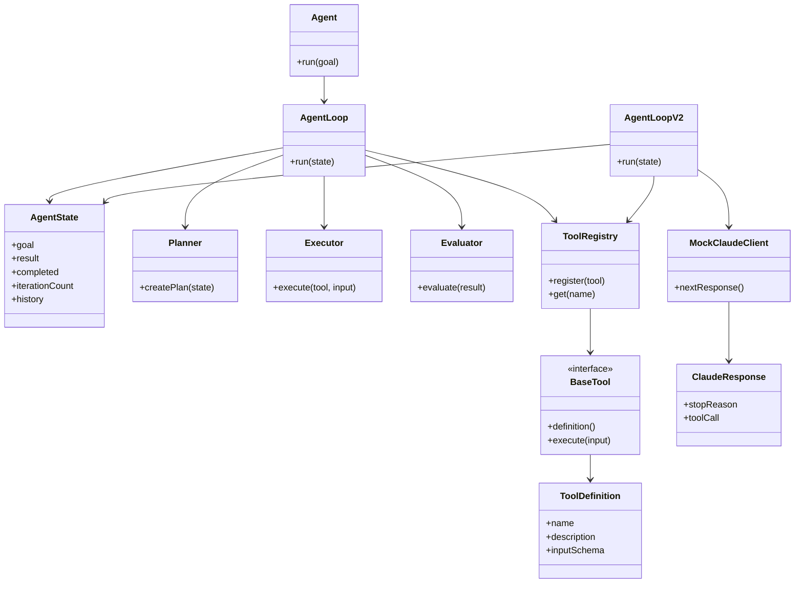
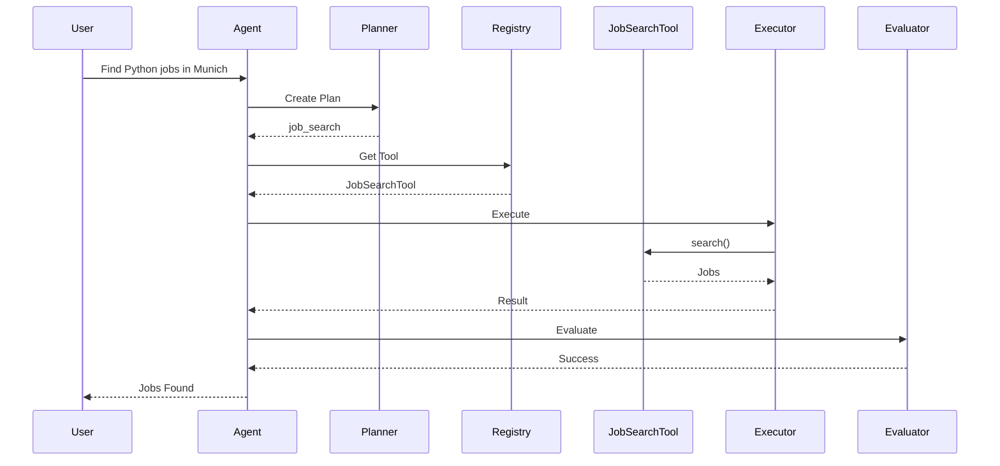

# Catalyst Architecture

## Setup

```bash
python -m venv .venv
.venv\Scripts\activate
pip install -e .
pip list
```

---

## Phases

| Phase | Focus | Decision maker |
|-------|-------|----------------|
| 1 | Agent architecture (Agent, AgentState, Planner, Executor, Evaluator, AgentLoop, tools) | `Planner` (rules) |
| 2 | Claude-style tool loop (`StopReason`, `ToolCall`, `ToolResult`, `ClaudeResponse`, `MockClaudeClient`, `AgentLoopV2`) | `MockClaudeClient` |
| 2.5 | Sequential tool calls: `TOOL_USE` -> `TOOL_USE` -> `END_TURN` | `MockClaudeClient` |
| 3 (next) | Replace `MockClaudeClient` with the Anthropic SDK (`client.messages.create()`) | Real Claude |

Details: `catalyst-java/Catalyst_Phase1_Agent_Architecture.md`, `catalyst-java/Catalyst_Phase2_Claude_Tool_Loop.md`.
Study guide (single HTML): `catalyst-java/go-to/Catalyst_Prep_Guide.html`.

---

## Agent Architecture (Phase 1)



---

## Claude Tool Loop (Phase 2 / 2.5)



`MAX_ITERATIONS = 20` is only a safety cap. `END_TURN` is the normal exit.

---

## Core Components



---

## Request Flow (Phase 1)



---

## Current Project Structure

```text
catalyst-java/

├── pom.xml
├── Catalyst_Phase1_Agent_Architecture.md
├── Catalyst_Phase2_Claude_Tool_Loop.md
├── go-to/
│   └── Catalyst_Prep_Guide.html
│
└── src/
    ├── main/
    │   └── java/
    │       └── com/
    │           └── catalyst/
    │               │
    │               ├── Application.java
    │               │
    │               ├── core/
    │               │   ├── Agent.java
    │               │   ├── AgentState.java
    │               │   ├── Planner.java
    │               │   ├── Executor.java
    │               │   ├── Evaluator.java
    │               │   ├── AgentLoop.java
    │               │   └── AgentLoopV2.java
    │               │
    │               ├── anthropic/
    │               │   ├── StopReason.java
    │               │   ├── ToolCall.java
    │               │   ├── ToolResult.java
    │               │   ├── ClaudeResponse.java
    │               │   └── MockClaudeClient.java
    │               │
    │               ├── domain/
    │               │   └── Job.java
    │               │
    │               ├── phases/
    │               │   ├── Phase1Runner.java
    │               │   └── Phase2Runner.java
    │               │
    │               └── tools/
    │                   ├── BaseTool.java
    │                   ├── ToolDefinition.java
    │                   ├── ToolRegistry.java
    │                   ├── JobSearchTool.java
    │                   ├── ResumeAnalyzerTool.java
    │                   ├── CalculatorTool.java
    │                   └── WebSearchTool.java
    │
    └── test/
        └── java/
            └── com/
                └── catalyst/
                    ├── PlannerTest.java
                    ├── ToolRegistryTest.java
                    ├── AgentLoopTest.java
                    ├── AgentTest.java
                    └── anthropic/
                        ├── StopReasonTest.java
                        ├── ToolCallTest.java
                        ├── ClaudeResponseTest.java
                        ├── MockClaudeClientTest.java
                        ├── AgentLoopV2Test.java
                        └── SequentialToolExecutionTest.java
```

```text
catalyst-python/

├── pyproject.toml
│
├── catalyst/
│
│   ├── core/
│   │   ├── agent.py
│   │   ├── state.py
│   │   ├── planner.py
│   │   ├── executor.py
│   │   └── evaluator.py
│   │
│   ├── domain/
│   │   └── job.py
│   │
│   ├── tools/
│   │   ├── base_tool.py
│   │   ├── registry.py
│   │   └── job_search_tool.py
│   │
│   ├── agents/
│   │
│   ├── workflows/
│   │
│   ├── context/
│   │
│   ├── memory/
│   │
│   └── mcp/
│
└── tests/
```

---

## Learning Objective (1.1 Agentic Loops)

```text
Goal
 ↓
Plan
 ↓
Select Tool
 ↓
Execute Tool
 ↓
Observe Result
 ↓
Evaluate
 ↓
Respond
```

Claude-style loop (Phase 2+):

```text
Send history -> inspect stop_reason
  tool_use -> run tool, append tool_result, repeat
  end_turn -> return final response
```

Everything later in the Claude Code Certification builds on:

```text
Agent
AgentState
Planner
Executor
Evaluator
AgentLoop / AgentLoopV2
ToolRegistry
StopReason
```
