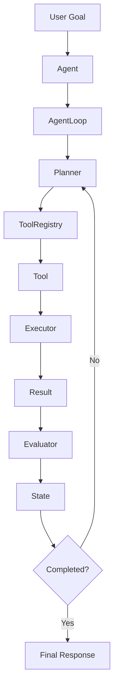

# Catalyst Phase 1 - Agentic Architecture Foundation

## Objective

Build and understand the foundational agent architecture before introducing Claude API integration, tool calling, `stop_reason`, MCP, or multi-agent orchestration.

Phase 1 focuses on six core classes:

```text
Agent
AgentState
Planner
Executor
Evaluator
AgentLoop
```

and the supporting tool infrastructure:

```text
ToolDefinition
BaseTool
ToolRegistry
JobSearchTool
ResumeAnalyzerTool
```

---

# Architecture Overview



---

# Repository Structure

```text
catalyst-java/

├── pom.xml
│
└── src/
    ├── main/
    │   └── java/
    │       └── com/
    │           └── catalyst/
    │
    │               ├── Application.java
    │
    │               ├── core/
    │               │   ├── Agent.java
    │               │   ├── AgentState.java
    │               │   ├── Planner.java
    │               │   ├── Executor.java
    │               │   ├── Evaluator.java
    │               │   └── AgentLoop.java
    │               │
    │               └── tools/
    │                   ├── BaseTool.java
    │                   ├── ToolDefinition.java
    │                   ├── ToolRegistry.java
    │                   ├── JobSearchTool.java
    │                   └── ResumeAnalyzerTool.java
    │
    └── test/
        └── java/
            └── com/
                └── catalyst/
                    ├── PlannerTest.java
                    ├── ToolRegistryTest.java
                    ├── AgentLoopTest.java
                    └── AgentTest.java
```

---

# Core Responsibilities

## Agent

Entry point for executing goals.

```text
Goal
 ↓
Agent
 ↓
AgentLoop
```

## AgentState

Stores execution state.

```text
Goal
Result
History
Iteration Count
Completed Flag
```

## Planner

Chooses what should happen next.

Examples:

```text
search java jobs
    → job_search

analyze my resume
    → resume_analyzer
```

## Executor

Executes the selected tool.

```text
Tool
 ↓
execute()
```

## Evaluator

Determines whether execution should continue.

Current:

```text
result != null
```

Future:

```text
TOOL_USE
END_TURN
```

## AgentLoop

The heart of the architecture.

```text
Plan
 ↓
Execute
 ↓
Evaluate
 ↓
Repeat
```

---

# Testing Strategy

## PlannerTest

Validates:

```text
Goal → Tool Selection
```

## ToolRegistryTest

Validates:

```text
Tool Registration
Tool Lookup
```

## AgentLoopTest

Validates:

```text
Loop Execution
Iteration Tracking
Completion Logic
```

## AgentTest

Validates:

```text
End-to-End Agent Flow
```

---

# Current Learning Outcome

By completing Phase 1 you will understand:

```text
Agent
Agent State
Planning
Execution
Evaluation
Tool Registry
Tool Selection
Iteration Loop
Safety Boundaries
```

---

# Next Phase (Claude Integration)

After all tests pass:

```text
✅ PlannerTest
✅ ToolRegistryTest
✅ AgentLoopTest
✅ AgentTest
```

Introduce:

```text
StopReason
ClaudeResponse
MockClaudeClient
Tool Calls
TOOL_USE
END_TURN
MAX_ITERATIONS
```

This aligns directly with the Claude Certification Agentic Loop requirements.
