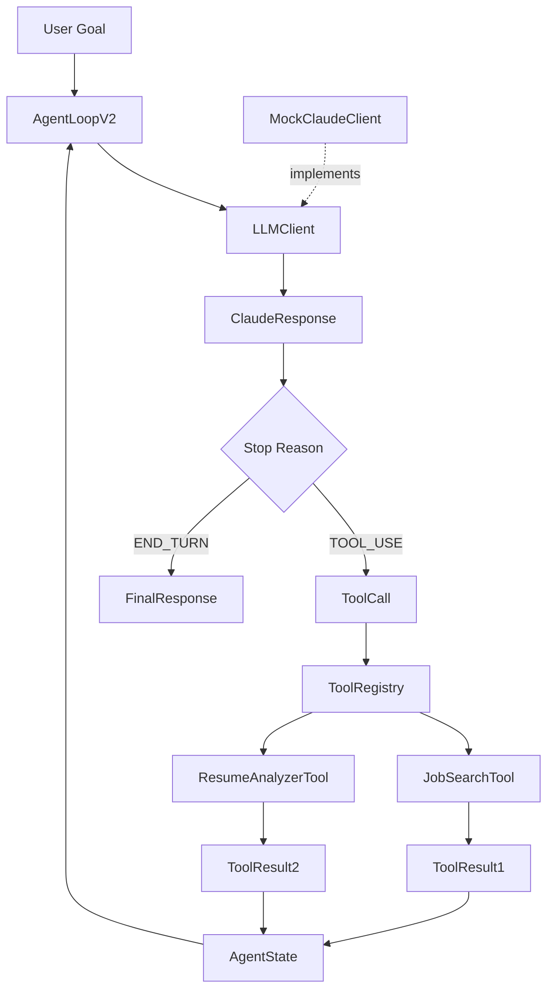
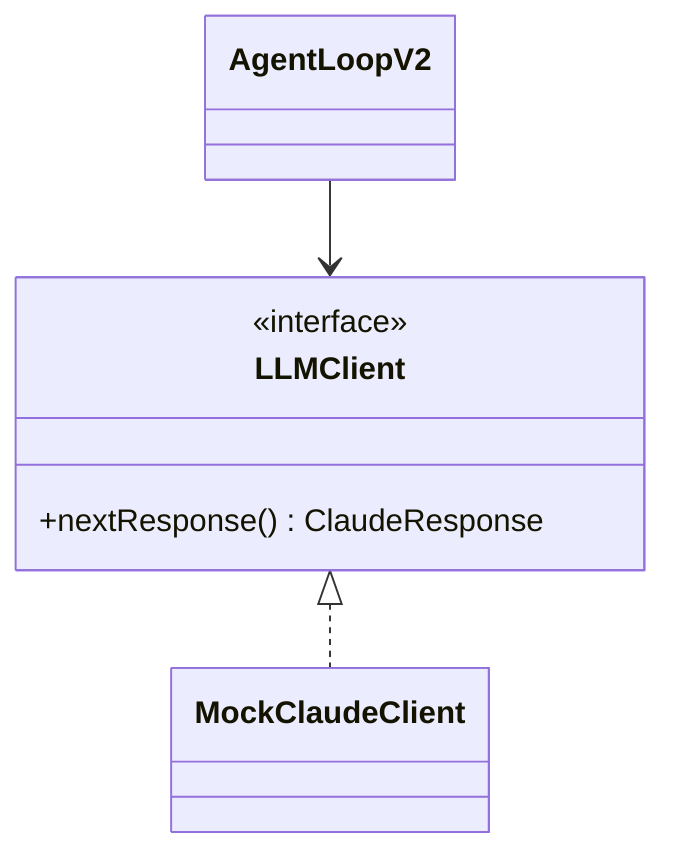
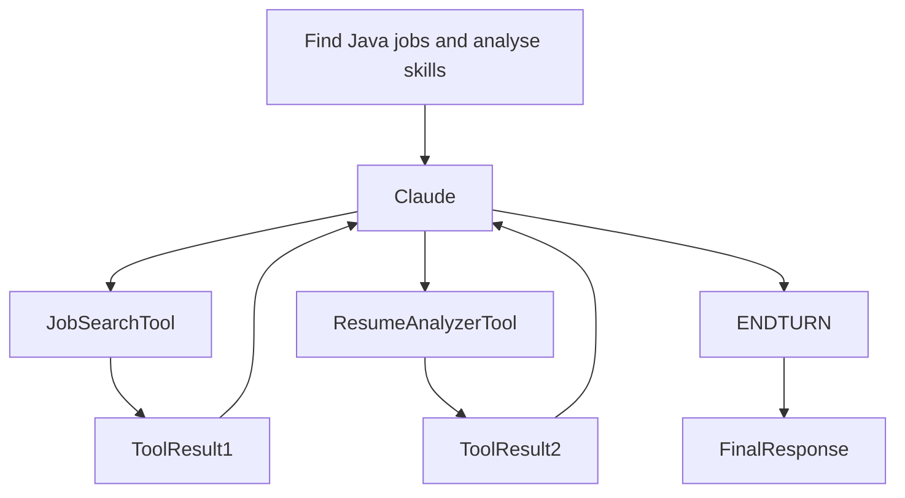

# Catalyst Phase 2 - Claude Tool Loop & Sequential Tool Calls

## Objective

Build a Claude-style execution loop while preserving the Catalyst architecture.

Phase 2 introduces:

```text
StopReason
ClaudeResponse
ToolCall
ToolResult
LLMClient (interface)
MockClaudeClient
AgentLoopV2
```

The goal is to understand Claude's:

```text
TOOL_USE
END_TURN
```

execution model before integrating the real Anthropic SDK.

---

# Architecture Overview



---

# New Components

## StopReason

Represents Claude decision outcomes.

```text
TOOL_USE
END_TURN
```

Equivalent:

```javascript
response.stop_reason
```

---

## ToolCall

Represents Claude requesting an action.

Example:

```text
job_search
resume_analyzer
```

---

## ToolResult

Represents the returned output from a tool.

Example:

```text
Matching Jobs Found
```

---

## ClaudeResponse

Represents what Claude wants to do next.

Possible responses:

```text
TOOL_USE
```

or

```text
END_TURN
```

---

## LLMClient

The interface for the "what next?" slot of the loop.

```java
public interface LLMClient {

    ClaudeResponse nextResponse();
}
```

`AgentLoopV2` depends on `LLMClient`, not on a concrete class.

Implementations:

```text
MockClaudeClient   scripted responses (learning / tests)
real SDK client    client.messages.create() (later phase)
```

Swapping the mock for the real client needs no change to the loop.



---

## MockClaudeClient

Implements `LLMClient`. Simulates Claude behaviour locally.

Purpose:

```text
Learning
Testing
Debugging
```

without:

```text
API Keys
Credits
Internet
```

---

# Repository Structure

```text
anthropic/

├── StopReason.java
├── ToolCall.java
├── ToolResult.java
├── ClaudeResponse.java
├── LLMClient.java
└── MockClaudeClient.java
```

---

# AgentLoopV2

Equivalent Claude Certification Pattern:

```javascript
while (true) {

    const response =
        await client.messages.create();

    if(response.stop_reason === "tool_use") {
        executeTool();
        continue;
    }

    if(response.stop_reason === "end_turn") {
        break;
    }
}
```

Catalyst Version:

```java
while (!state.isCompleted()) {

    // client is an LLMClient
    ClaudeResponse response =
            client.nextResponse();

    if(response.stopReason()
            == StopReason.TOOL_USE) {

        executeTool();

        continue;
    }

    if(response.stopReason()
            == StopReason.END_TURN) {

        state.setCompleted(true);

        break;
    }
}
```

---

# Safety Cap

```java
private static final int MAX_ITERATIONS = 20;
```

Purpose:

```text
Protect against runaway loops
```

Primary stopping mechanism remains:

```text
END_TURN
```

---

# Certification Mapping

| Claude Certification | Catalyst |
|----------|-----------|
| tools[] | ToolRegistry |
| tool_use | StopReason.TOOL_USE |
| tool_result | ToolResult |
| end_turn | StopReason.END_TURN |
| messages[] | AgentState |
| client.messages.create() | LLMClient (MockClaudeClient today) |
| while(true) | AgentLoopV2 |
| MAX_ITERATIONS | AgentLoopV2 |

---

# Phase 2.5 - Sequential Tool Calls

## Objective

Introduce multi-step reasoning through sequential tool execution.

Target flow:

```text
TOOL_USE
 ↓
TOOL_USE
 ↓
END_TURN
```

---

## Sequential Tool Architecture



---

## Iteration Flow

### Iteration 1

```text
TOOL_USE
job_search
```

### Iteration 2

```text
TOOL_USE
resume_analyzer
```

### Iteration 3

```text
END_TURN
```

---

## Expected Agent State

```text
iterationCount = 3
history size = 2
completed = true
stopReason = END_TURN
finalResponse available
```

---

## Tests Covered

```text
StopReasonTest
ToolCallTest
ClaudeResponseTest
MockClaudeClientTest
AgentLoopV2Test
SequentialToolExecutionTest
```

---

# Learning Outcomes

```text
TOOL_USE
END_TURN
Tool Execution
Tool Results
Sequential Tool Calls
Conversation State
Multi-Step Reasoning
MAX_ITERATIONS
Claude Style Agent Loops
```

---

# Transition To The Real SDK (later phase)

Add a real `LLMClient` implementation:

```text
class ... implements LLMClient
    wraps Anthropic SDK client.messages.create()
```

and pass it to `AgentLoopV2` instead of `MockClaudeClient`.

while keeping:

```text
AgentState
AgentLoopV2
ToolRegistry
ToolCall
ToolResult
StopReason
```

unchanged.
