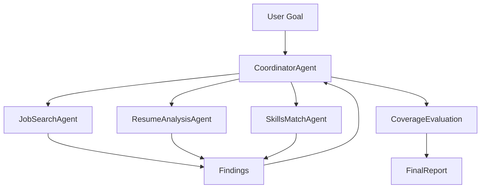
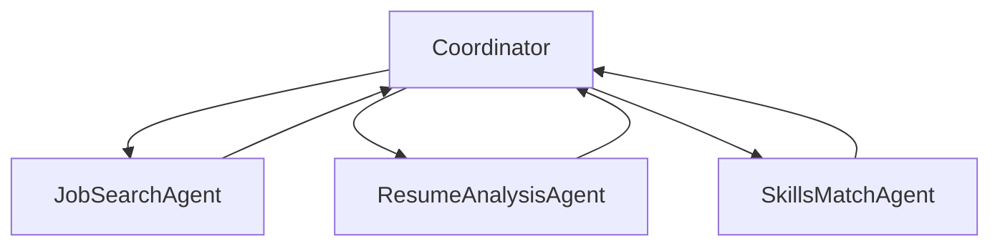

# Catalyst Phase 3 - Multi-Agent Orchestration

## Objective

Build a Hub-and-Spoke Research Coordinator.

Phase 3 introduces:

```text
CoordinatorAgent
JobSearchAgent
ResumeAnalysisAgent
SkillsMatchAgent
SubTopic
ResearchFinding
ResearchReport
CoverageReport
```

The goal is to understand how a coordinator agent decomposes work, delegates to specialist subagents, aggregates findings, evaluates coverage, and produces a final report.

---

# Architecture Overview



---

# Hub-and-Spoke Pattern



## Key Rule

```text
Subagents do not talk to each other.

All communication flows through the CoordinatorAgent.
```

---

# New Components

## CoordinatorAgent

Responsibilities:

```text
Decompose
Delegate
Aggregate
Evaluate Coverage
Refine
```

## JobSearchAgent

Researches:

```text
Jobs
Companies
Locations
```

## ResumeAnalysisAgent

Researches:

```text
Resume Strengths
Resume Weaknesses
Skill Gaps
```

## SkillsMatchAgent

Researches:

```text
Skill Matching
Recommendations
Career Alignment
```

---

# Repository Structure

```text
agents/

├── CoordinatorAgent.java
├── JobSearchAgent.java
├── ResumeAnalysisAgent.java
└── SkillsMatchAgent.java

model/

├── SubTopic.java
├── ResearchFinding.java
├── ResearchReport.java
└── CoverageReport.java
```

---

# Multi-Agent Flow

## Step 1 - Decompose

User Goal:

```text
Find Java jobs in Munich and recommend the best opportunities
```

Coordinator creates:

```text
Job Search
Resume Analysis
Skills Match
Salary Analysis
Market Trends
```

---

## Step 2 - Delegate

```text
Coordinator
   ↓
JobSearchAgent

Coordinator
   ↓
ResumeAnalysisAgent

Coordinator
   ↓
SkillsMatchAgent
```

---

## Step 3 - Aggregate

All findings return to:

```text
CoordinatorAgent
```

which builds:

```text
ResearchReport
```

---

## Step 4 - Coverage Evaluation

Coordinator creates:

```text
CoverageReport
```

containing:

```text
Covered Topics
Missing Topics
Completeness Percentage
```

---

# Coverage Evaluation Example

```text
Covered
--------
Job Search
Resume Analysis
Skills Match
Salary Analysis
Market Trends

Completeness
------------
100%
```

---

# Tests Covered

```text
CoordinatorAgentTest
JobSearchAgentTest
ResumeAnalysisAgentTest
SkillsMatchAgentTest
```

Current milestone:

```text
18+ Passing Tests
```

---

# Certification Mapping

| Certification Concept | Catalyst |
|----------------------|-----------|
| Research Coordinator | CoordinatorAgent |
| Web Search Agent | JobSearchAgent |
| Document Analysis Agent | ResumeAnalysisAgent |
| Coverage Evaluation | CoverageReport |
| Aggregation | ResearchReport |
| Task Decomposition | CoordinatorAgent.decompose() |
| Delegation | CoordinatorAgent.delegate() |
| Hub-and-Spoke | Coordinator Architecture |

---

# Learning Outcomes

After Phase 3 you understand:

```text
Multi-Agent Orchestration
Hub-and-Spoke Architecture
Coordinator Ownership
Task Decomposition
Delegation
Aggregation
Coverage Evaluation
```

---

# Transition To Phase 4

Phase 3 assumes that subagents receive all necessary context.

Phase 4 introduces:

```text
ResearchContext
Explicit Context Passing
Subagent Isolation
Shared Context Validation
```

which maps directly to:

```text
1.3 Subagent Invocation and Context Passing
```
