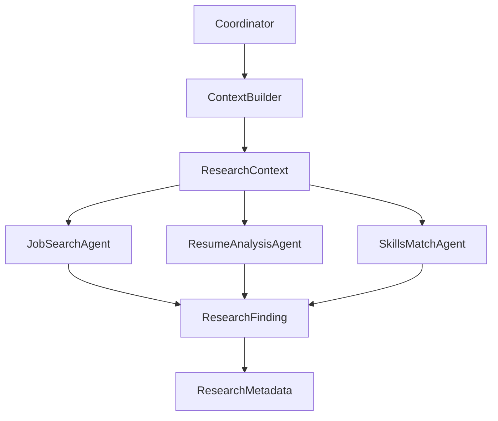
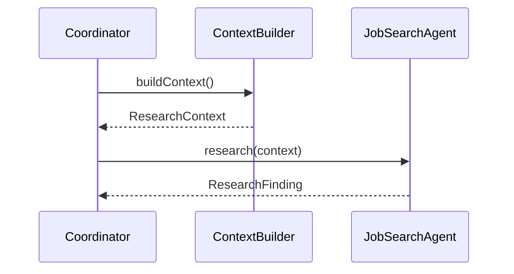

# Catalyst Phase 4 - Subagent Invocation & Context Passing

## Objective

Implement explicit context passing between the CoordinatorAgent and subagents.

Phase 4 introduces:

```text
ResearchContext
ResearchMetadata
ResearchFinding
ResearchOutput
ContextBuilder
Phase4Runner
```

The goal is to demonstrate that subagents are isolated and only know what the coordinator explicitly passes.

---

# Key Certification Concept

```text
Subagents have NO shared memory.
```

Incorrect:

```text
ResumeAnalysisAgent automatically knows
what JobSearchAgent discovered.
```

Correct:

```text
Coordinator
    ↓
ResearchContext
    ↓
Subagent
```

---

# Architecture Overview



---

# New Components

## ResearchContext

Contains:

```text
Original Goal
Assigned SubTopic
Expected Output
Prior Findings
```

Example:

```java
ResearchContext(
    "Find Java jobs",
    "Job Search",
    "Provide findings",
    "Salary analysis complete"
)
```

---

## ResearchMetadata

Separates attribution from content.

Contains:

```text
Source URL
Document Name
Page Number
Confidence
Retrieved By
```

---

## ResearchFinding

Refactored to:

```java
ResearchFinding(
    claim,
    analysis,
    metadata
)
```

This enables:

```text
Attribution
Provenance
Traceability
```

---

## ContextBuilder

Creates consistent context objects.

```text
Coordinator
    ↓
ContextBuilder
    ↓
ResearchContext
```

---

# Repository Structure

```text
context/
└── ContextBuilder.java

model/
├── ResearchContext.java
├── ResearchMetadata.java
├── ResearchFinding.java
└── ResearchOutput.java

phases/
└── Phase4Runner.java
```

---

# Context Passing Flow



---

# Metadata Preservation

Every finding carries:

```text
Claim
Analysis
Metadata
```

Metadata contains:

```text
sourceUrl
documentName
pageNumber
confidence
retrievedBy
```

---

# Tests Covered

```text
ResearchContextTest
ResearchMetadataTest
ContextBuilderTest
ContextPassingTest
MetadataPreservationTest
SubagentIsolationTest
```

---

# Learning Outcomes

After Phase 4 you understand:

```text
Subagent Isolation
Explicit Context Passing
Metadata Preservation
Source Attribution
Context Construction
Provenance Tracking
```

---

# Certification Mapping

| Certification Concept | Catalyst |
|----------------------|-----------|
| Context Passing | ResearchContext |
| Structured Metadata | ResearchMetadata |
| Source Attribution | ResearchFinding.metadata |
| Agent Isolation | ResearchContext-only access |
| Context Construction | ContextBuilder |
| Provenance Tracking | retrievedBy |

---

# Completion Criteria

```text
✅ ResearchContext
✅ ResearchMetadata
✅ ResearchOutput
✅ ContextBuilder
✅ ContextPassingTest
✅ MetadataPreservationTest
✅ SubagentIsolationTest
✅ Phase4Runner
```

---

# Transition To Phase 5

Next Certification Topic:

```text
1.4 Workflow Enforcement & Handoff
```

Upcoming concepts:

```text
WorkflowStep
WorkflowState
WorkflowEngine
Agent Hand-Offs
Allowed Transitions
Workflow Validation
```
