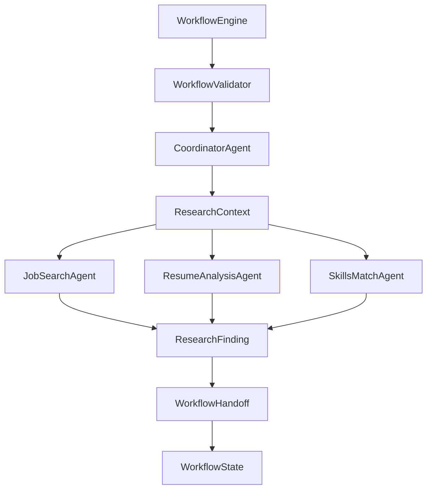
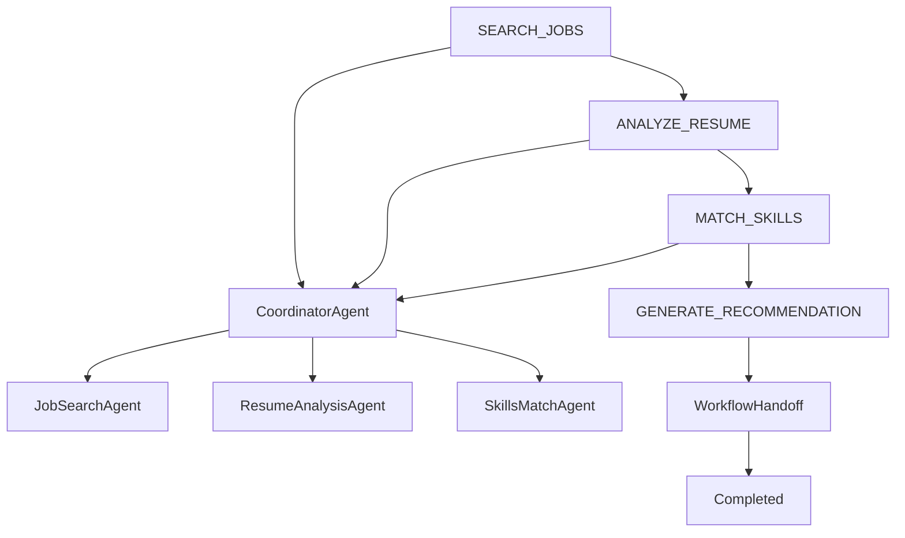

# Catalyst Phase 5 - Workflow Enforcement & Handoff

## Objective

Implement deterministic workflow execution using prerequisite gates and structured handoff protocols.

Phase 5 introduces:

```text
WorkflowStep
WorkflowStatus
WorkflowState
WorkflowValidator
WorkflowEngine
JobApplicationWorkflow
WorkflowHandoff
HandoffBuilder
```

The goal is to ensure workflow steps cannot execute until all required prerequisites have been completed.

---

# Key Certification Concept

```text
Prompts are not enforcement.
Code is enforcement.
```

---

# Updated Architecture Overview



---

# Workflow Controls Agent Execution

Before this phase:

```text
CoordinatorAgent
and
WorkflowEngine
were separate systems.
```

After this phase:

```text
WorkflowEngine
      ↓
CoordinatorAgent
      ↓
Subagents
```

The workflow governs when agents are allowed to execute.

---

# Full Execution Flow



---

# Structured Handoff

WorkflowHandoff contains:

```text
workflowId
originalGoal
conversationSummary
rootCauseAnalysis
recommendedAction
```

---

# Tests Covered

```text
WorkflowValidatorTest
WorkflowHandoffTest
WorkflowCoordinatorIntegrationTest
```

---

# Learning Outcomes

```text
Workflow Enforcement
Prerequisite Gates
Deterministic Execution
Coordinator Governance
Workflow Controlled Agent Execution
Structured Handoffs
State-Based Validation
Allowed Workflow Transitions
Blocking Invalid Operations
Agent Handoffs
```

---

# Completion Criteria

```text
✅ WorkflowStep
✅ WorkflowStatus
✅ WorkflowState
✅ WorkflowValidator
✅ WorkflowEngine
✅ JobApplicationWorkflow
✅ WorkflowHandoff
✅ HandoffBuilder
✅ WorkflowValidatorTest
✅ WorkflowHandoffTest
✅ WorkflowEngine wired to CoordinatorAgent
```

---

# Transition To Phase 6

Next Certification Topic:

```text
1.5 Agent SDK Hooks
```
